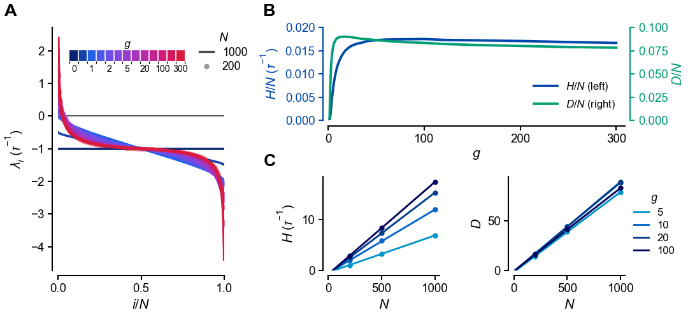

# Chaotic recurrent networks: full Lyapunov spectra

[](https://github.com/valeriefong/chaotic-recurrent-networks/actions/workflows/tests.yml)

Dynamical models of recurrent neural networks are useful tools for understanding the relationship
between network connectivity and the resulting firing-rate dynamics. This repository computes the full
Lyapunov spectrum of such networks in PyTorch. Characterizing the full spectrum offers much more
information than whether chaotic dynamics exist: from it we learn about the specific nature of the
chaotic behavior through the Kolmogorov-Sinai entropy rate and the Kaplan-Yorke attractor dimension.


*Figure 1. (A) Increasing the overall connection strength through the gain parameter $g$ induces a sharp
transition from stable to chaotic dynamics in the random network ($N = 1000$; $g = 0.9$, 2 and 5).
(B) The three architectures ($N = 1000$; $g = 2$ for Random and Dynamically critical, $g = 7$ for Barcode).
Left: schematics of connections between a subset of neurons; orange lines represent excitatory and gray
lines inhibitory connections, with relative strength shown by line thickness; loops are
self-connections. Middle: eigenvalues of the connectivity matrices, in units of $g$; Barcode's outlier at
about $\mu = -40$ lies off the axis. Right: example traces of single-neuron activity.*

## Background

Introducing nonlinearity into a recurrent network generates more complex dynamics, including chaos,
when sufficiently strong connections between neurons exist. A classical example is the firing-rate
model with weights sampled from a Gaussian distribution and a tanh activation function. Sompolinsky,
Crisanti and Sommers (1988) characterized its transition to chaos by varying a gain parameter that
controls the overall strength of connections: in the large-network limit, the dynamics transition from
stable to chaotic at the critical gain $g_c = 1$. Engelken, Wolf and Abbott (2023) characterized the full
Lyapunov spectrum of this model.

More recently proposed network models have distinct connectivity structures and stabilization
mechanisms that generate chaotic dynamics. This code applies the same analysis to two of them:

- **Dynamically critical (DC) networks**, defined by their many dynamic modes on the edge of instability
  (Magnasco et al., 2009; Magnasco, 2022). Unlike the random network, in which a small number of modes
  lose stability at the onset of chaos, the DC construction places an extensive set of modes near
  instability, so many must lose stability at once.
- **Barcode networks** (Fang et al., 2025), which use a ReLU activation function and stabilize recurrent
  activity with global inhibition and an activity-dependent leak that tracks overall network activity.

## What it does

- **Three network models** that share the goal of modeling firing-rate dynamics but differ in their
  connectivity structure and stabilization mechanisms: the classical random network, a DC network with
  about 30% of its connectivity eigenvalues placed on the edge of instability, and the Barcode network.
  The analysis focuses on autonomous dynamics, in the absence of input.
- **Full Lyapunov spectrum** by the QR (Benettin) method, integrating the state with fourth-order
  Runge-Kutta and the tangent vectors with the exact tangent map of that RK4 step (forward Euler is
  also available).
- **Summary measures** from the spectrum: the largest exponent $\lambda_1$, the entropy rate $H$ (sum of the
  positive exponents) and the Kaplan-Yorke attractor dimension $D$.
- **Tested at scale**: networks up to $N = 2000$, more than 21,000 simulations run on a university
  computing cluster.

## Install

```bash
git clone https://github.com/valeriefong/chaotic-recurrent-networks.git
cd chaotic-recurrent-networks
pip install -e .            # add ".[dev]" for pytest and the notebook tools
```

Requires Python 3.11 or later and PyTorch 2.0 or later; runs on CPU.

## Usage

```python
from rnn_lyapunov import RandomRNN, LyapunovSpectrum

net = RandomRNN(N=100, g=3.0, seed_net=0)       # random network with gain g
result = LyapunovSpectrum(net).compute(
    T_sim=300.0, dt=0.05,                       # averaging time and step (units of tau)
    T_transient=50.0, T_ONS_warmup=20.0,        # discarded transient and warm-up
    integrator="rk4",                           # RK4 with its exact tangent map
)
print(f"largest exponent: {result.max_exponent:.3f}")
print(f"entropy rate H:   {result.entropy:.3f}")
print(f"dimension D:      {result.lyapunov_dimension:.2f}")
```

The other two models are built the same way:

```python
from rnn_lyapunov import DynamicallyCriticalRNN, BarcodeRNN

dc = DynamicallyCriticalRNN(N=100, g=2.0, seed_net=0, critical_modes_fraction=0.30)
barcode = BarcodeRNN(N=100, g=7.0, seed_net=0, keep_diag=True)
```

Some defaults are kept for compatibility (`integrator="euler"`, `keep_diag=False`,
`critical_modes=1`), so pass these settings explicitly. [`examples/quickstart.ipynb`](examples/quickstart.ipynb)
walks through building and simulating the models (it reproduces the traces in Figure 1) and computing
a spectrum.

## Method in brief

For the random network of $N$ neurons, the continuous-time dynamics are

```math
\tau \frac{dx_i}{dt} = -x_i + g \sum_{j=1}^{N} W_{ij} \tanh(x_j), \qquad i = 1, \dots, N,
```

where $x_i$ is the firing rate of neuron $i$, the weights $W_{ij}$ are sampled from a Gaussian
distribution with mean zero and variance $1/N$, autapses are removed ($W_{ii} = 0$), $\tau = 1$, and the
dimensionless gain $g$ controls the overall coupling strength. The Jacobian of the dynamics is

```math
J(x) = -I + g\, W \operatorname{diag}\!\left(\operatorname{sech}^2 x\right).
```

Along a trajectory, an arbitrarily small perturbation $\delta x$ evolves according to the variational
equation $d\,\delta x/dt = J(x(t))\, \delta x$. Each Lyapunov exponent is the asymptotic rate of
exponential growth or collapse of such a perturbation; an $N$-dimensional state space has $N$ of them,
$\lambda_1 \ge \lambda_2 \ge \dots \ge \lambda_N$. When $\lambda_1 > 0$, nearby trajectories diverge
exponentially, reflecting sensitive dependence on initial conditions: the hallmark of chaos.

The full spectrum is estimated with the standard iterative Jacobian-based method of Shimada and
Nagashima (1979) and Benettin et al. (1980):

1. An $N \times N$ system of orthonormal perturbation vectors $Q$ is evolved alongside the trajectory.
   The network is integrated with fixed-step fourth-order Runge-Kutta (RK4), and $Q$ is advanced with
   the derivative of the same discrete RK4 step.
2. Every $T_\mathrm{ONS}$, a QR decomposition reorthonormalizes the perturbations. This prevents
   collapse onto the dominant direction of exponential divergence, which would lose all information
   about the other $N - 1$ directions.
3. The exponents are estimated by accumulating $\log \lvert R_{ii} \rvert$, the logarithms of the
   diagonal entries of $R$, and averaging over the accumulation time $T$:

```math
\lambda_i \approx \frac{1}{T} \sum_m \log \left\lvert R_{ii}^{(m)} \right\rvert .
```

The Kolmogorov-Sinai entropy rate, a rate of information generation, is the sum of all positive
exponents (Pesin's identity),

```math
H = \sum_{\lambda_i > 0} \lambda_i .
```

The Kaplan-Yorke dimension estimates the dimensionality of a chaotic attractor,

```math
D = k + \frac{\sum_{i=1}^{k} \lambda_i}{\lvert \lambda_{k+1} \rvert},
```

where $k$ is the largest index such that the cumulative sum of exponents is non-negative.

## Validation

- **Unit tests** (`tests/`, run on every push):
  - for a linear network the spectrum is known in closed form (the real parts of the Jacobian's
    eigenvalues), and `compute()` recovers it;
  - hand-derived Jacobians match automatic differentiation;
  - the RK4 tangent map matches finite differences of the RK4 step;
  - the RK4 convergence order is measured, not assumed;
  - on a linear network, RK4's bias is more than 100 times smaller than Euler's at the same step.
- **Published results**: for the random network, the spectra, entropy rate and dimension reproduce
  Engelken, Wolf & Abbott (2023) (Figure 2).
- **Reference implementation**: the solver was validated against the published reference
  implementation of Engelken et al. (2023). The scripts for this check are not included, because the
  reference code has no license.



*Figure 2. The random network. (A) Lyapunov spectra $\lambda_i$ against $i/N$ for $N = 1000$ (lines) and $N = 200$
(dots); colours index gain $g$, one band per plotted gain. (B) Entropy rate $H/N$ and dimension $D/N$ against
$g$, $N = 1000$. (C) $H$ and $D$ grow linearly with $N$ at fixed $g$ (extensive chaos). Mean over 20 networks per
point; $T_\mathrm{sim} = 1000\,\tau$, RK4. These reproduce Engelken et al. (2023).*

## Repository layout

```
rnn_lyapunov/
  models/            network models (base class with Euler and RK4 integrators; Random, Dynamically
                     critical, Barcode; autograd and linear variants used in tests)
  analysis/lyapunov.py   LyapunovSpectrum (QR method) and LyapunovResult (λ₁, H, D)
tests/               pytest suite
examples/            quickstart notebook
figures/             figures shown above
```

## Status

A manuscript is in preparation. Results for the dynamically critical and Barcode networks are pending.

## Acknowledgements and attribution

`LyapunovSpectrum.compute()` is adapted from `demo_lypunov_spectra_chaotic_ratenetwork.py` by Rainer
Engelken ([RNN-LyapunovSpectra](https://github.com/RainerEngelken/RNN-LyapunovSpectra), commit
fb81838), the reference code for Engelken, Wolf & Abbott (2023). It keeps that code's loop structure,
step counting, QR accumulation and participation ratio, ported to PyTorch, with the RK4 integrator and
its exact tangent map added. That code has no license, so this function is not covered by this
repository's MIT license.

## References

- Benettin G, Galgani L, Giorgilli A, Strelcyn JM (1980). Lyapunov characteristic exponents for smooth
  dynamical systems and for Hamiltonian systems; a method for computing all of them. Part 1: Theory.
  *Meccanica* 15, 9–20. https://doi.org/10.1007/BF02128236
- Benettin G, Galgani L, Giorgilli A, Strelcyn JM (1980). Lyapunov characteristic exponents for smooth
  dynamical systems and for Hamiltonian systems; a method for computing all of them. Part 2: Numerical
  application. *Meccanica* 15, 21–30. https://doi.org/10.1007/BF02128237
- Engelken R, Wolf F, Abbott LF (2023). Lyapunov spectra of chaotic recurrent neural networks.
  *Physical Review Research* 5, 043044. https://doi.org/10.1103/PhysRevResearch.5.043044
- Fang C, Lindsey JW, Abbott LF, Aronov D, Chettih SN (2025). Barcode activity in a recurrent network
  model of the hippocampus enables efficient memory binding. *eLife* 14, RP103512.
  https://doi.org/10.7554/eLife.103512
- Magnasco MO, Piro O, Cecchi GA (2009). Self-tuned critical anti-Hebbian networks. *Physical Review
  Letters* 102, 258102. https://doi.org/10.1103/PhysRevLett.102.258102
- Magnasco MO (2022). Robustness and flexibility of neural function through dynamical criticality.
  *Entropy* 24, 591. https://doi.org/10.3390/e24050591
- Shimada I, Nagashima T (1979). A numerical approach to ergodic problem of dissipative dynamical
  systems. *Progress of Theoretical Physics* 61, 1605–1616. https://doi.org/10.1143/PTP.61.1605
- Sompolinsky H, Crisanti A, Sommers HJ (1988). Chaos in random neural networks. *Physical Review
  Letters* 61, 259–262. https://doi.org/10.1103/PhysRevLett.61.259

## Author and license

Valerie Fong · [GitHub](https://github.com/valeriefong) · [LinkedIn](https://www.linkedin.com/in/valfong/)

MIT License (see [LICENSE](LICENSE)), except `LyapunovSpectrum.compute()` as noted above.
