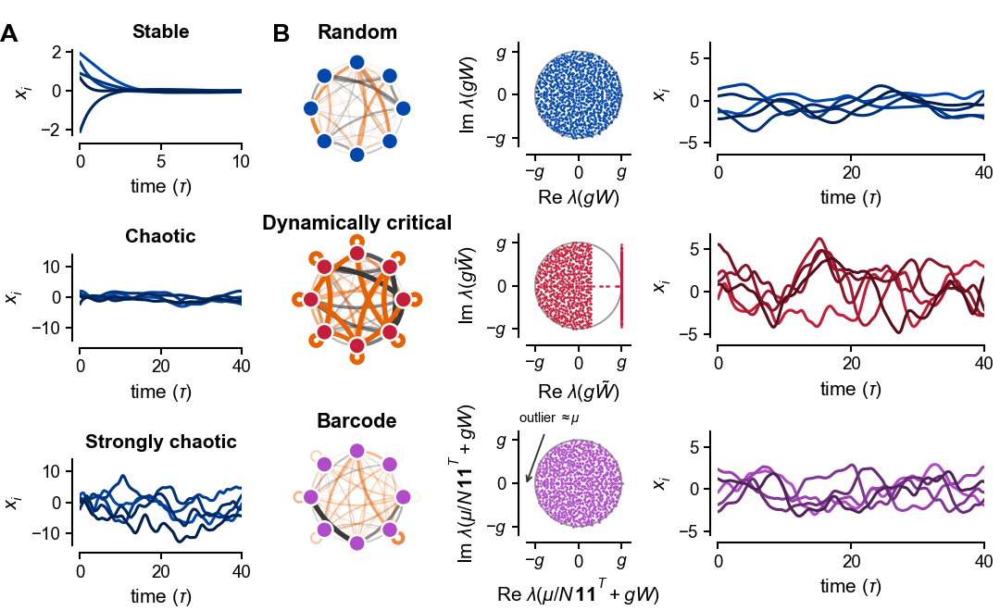

# Chaotic recurrent networks: full Lyapunov spectra

[](https://github.com/valeriefong/chaotic-recurrent-networks/actions/workflows/tests.yml)

PyTorch code for computing the full Lyapunov spectrum of recurrent neural networks, and with it how
chaotic a network is, how much information its dynamics generate, and how many dimensions its activity
explores.



*Figure 1. (A) One random network (N = 1000) at gain g = 0.9, 2 and 5: five unit activities x_i from a
random initial condition. (B) One network per model, N = 1000, with activity shown at g = 2 (Random,
Dynamically critical) and g = 7 (Barcode). Left: 8 units of the network; orange excitatory, grey
inhibitory, line width scaled by |w|; loops are self-connections. Middle: eigenvalues of the
connectivity matrix in units of g (grey circle: radius g); Barcode's outlier at about μ = −40 lies off
the axis. Right: five unit activities.*

## What it does

- **Three network models** with rate dynamics τ dx/dt = −x + W φ(x): a random network (Sompolinsky et
  al., 1988), a dynamically critical network with a fraction of its connectivity eigenvalues placed just
  below the instability boundary, and the Barcode network of Fang et al. (2025), which uses ReLU units
  and a state-dependent leak.
- **Full Lyapunov spectrum** by the QR (Benettin) method, integrating the state with fourth-order
  Runge-Kutta and the tangent vectors with the exact tangent map of that RK4 step (forward Euler is
  also available).
- **Summary measures** from the spectrum: the largest exponent λ₁, the entropy rate H (sum of the
  positive exponents) and the Kaplan-Yorke attractor dimension D.
- **Tested at scale**: networks up to N = 2000, more than 21,000 simulations run on a university
  computing cluster.

## Install

```bash
git clone https://github.com/valeriefong/chaotic-recurrent-networks.git
cd chaotic-recurrent-networks
pip install -e .            # add ".[dev]" for pytest and the notebook tools
```

Requires Python 3.11 or later and PyTorch 2.0 or later; runs on CPU.

## Usage

```python
from rnn_lyapunov import RandomRNN, LyapunovSpectrum

net = RandomRNN(N=100, g=3.0, seed_net=0)       # random network with gain g
result = LyapunovSpectrum(net).compute(
    T_sim=300.0, dt=0.05,                       # averaging time and step (units of tau)
    T_transient=50.0, T_ONS_warmup=20.0,        # discarded transient and warm-up
    integrator="rk4",                           # RK4 with its exact tangent map
)
print(f"largest exponent: {result.max_exponent:.3f}")
print(f"entropy rate H:   {result.entropy:.3f}")
print(f"dimension D:      {result.lyapunov_dimension:.2f}")
```

The other two models are built the same way:

```python
from rnn_lyapunov import DynamicallyCriticalRNN, BarcodeRNN

dc = DynamicallyCriticalRNN(N=100, g=2.0, seed_net=0, critical_modes_fraction=0.30)
barcode = BarcodeRNN(N=100, g=7.0, seed_net=0, keep_diag=True)
```

Some defaults are kept for compatibility (`integrator="euler"`, `keep_diag=False`,
`critical_modes=1`), so pass these settings explicitly. [`examples/quickstart.ipynb`](examples/quickstart.ipynb)
walks through building, simulating and analyzing the models.

## Method in brief

For the random network, the state x ∈ ℝᴺ follows

  τ dx/dt = −x + W tanh(x),  W_ij ~ N(0, g²/N), W_ii = 0.

A small perturbation δ evolves with the Jacobian, dδ/dt = J(x) δ, where
J(x) = (−I + W diag(sech² x)) / τ. The Lyapunov exponents are the average exponential growth rates of
perturbations in N independent directions. To measure them:

1. Evolve the state and an orthonormal set of N tangent vectors Q together, one RK4 step at a time,
   using the exact derivative of the RK4 step.
2. Every T_ONS, re-orthonormalize with a QR decomposition, Q ← QR. The diagonal of R records how much
   each direction stretched.
3. Average: λ_i = (1/T) Σ log |R_ii| over the run.

From the sorted spectrum λ₁ ≥ λ₂ ≥ … ≥ λ_N: H = Σ_{λ_i > 0} λ_i, and
D = M + (λ₁ + … + λ_M) / |λ_{M+1}|, where M is the largest index with λ₁ + … + λ_M ≥ 0.

## Validation

- **Unit tests** (`tests/`, run on every push):
  - for a linear network the spectrum is known in closed form (the real parts of the Jacobian's
    eigenvalues), and `compute()` recovers it;
  - hand-derived Jacobians match automatic differentiation;
  - the RK4 tangent map matches finite differences of the RK4 step;
  - the RK4 convergence order is measured, not assumed;
  - on a linear network, RK4's bias is more than 100 times smaller than Euler's at the same step.
- **Published results**: for the random network, the spectra, entropy rate and dimension reproduce
  Engelken, Wolf & Abbott (2023) (Figure 2).
- **Reference implementation**: the solver was validated against the published reference
  implementation of Engelken et al. (2023). Run in Euler mode, in double precision, from the same
  connectivity, initial state and initial basis, the two agree to rounding precision for non-chaotic
  networks and within finite-time noise for chaotic ones, where rounding differences grow
  exponentially. The scripts for this check are not included, because the reference code has no
  license.


*Figure 2. The random network. (A) Lyapunov spectra λ_i against i/N for N = 1000 (lines) and N = 200
(dots); colours index gain g, one band per plotted gain. (B) Entropy rate H/N and dimension D/N against
g, N = 1000. (C) H and D grow linearly with N at fixed g (extensive chaos). Mean over 20 networks per
point; T_sim = 1000 τ, RK4. These reproduce Engelken et al. (2023).*

## Repository layout

```
rnn_lyapunov/
  models/            network models (base class with Euler and RK4 integrators; Random, Dynamically
                     critical, Barcode; autograd and linear variants used in tests)
  analysis/lyapunov.py   LyapunovSpectrum (QR method) and LyapunovResult (λ₁, H, D)
tests/               pytest suite
examples/            quickstart notebook
figures/             figures shown above
```

## Status

A manuscript is in preparation. Results for the dynamically critical and Barcode networks will be
added after publication.

## Acknowledgements and attribution

`LyapunovSpectrum.compute()` is adapted from `demo_lypunov_spectra_chaotic_ratenetwork.py` by Rainer
Engelken ([RNN-LyapunovSpectra](https://github.com/RainerEngelken/RNN-LyapunovSpectra), commit
fb81838), the reference code for Engelken, Wolf & Abbott (2023). It keeps that code's loop structure,
step counting, QR accumulation and participation ratio, ported to PyTorch, with the RK4 integrator and
its exact tangent map added. That code has no license, so this function is not covered by this
repository's MIT license.

## References

- Engelken R, Wolf F, Abbott LF (2023). Lyapunov spectra of chaotic recurrent neural networks.
  *Physical Review Research* 5, 043044.
- Fang C, Lindsey JW, Abbott LF, Aronov D, Chettih SN (2025). *eLife* 14:RP103512.
- Sompolinsky H, Crisanti A, Sommers HJ (1988). Chaos in random neural networks. *Physical Review
  Letters* 61, 259.

## Author and license

Valerie Fong · [GitHub](https://github.com/valeriefong) · [LinkedIn](https://www.linkedin.com/in/valfong/)

MIT License (see [LICENSE](LICENSE)), except `LyapunovSpectrum.compute()` as noted above.
